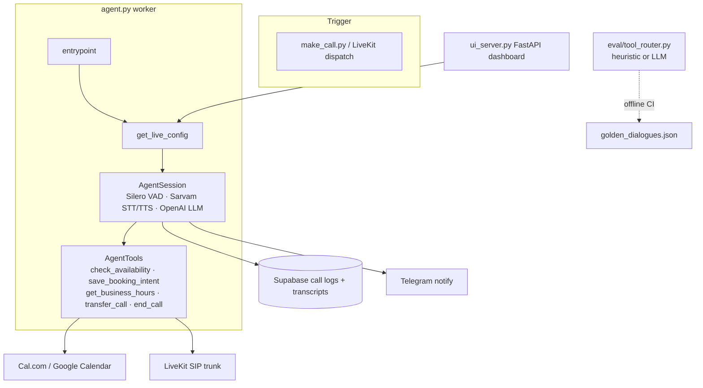

<div align="center">

# InboundAIVoice

### LiveKit outbound / inbound AI calling agent (fork)

*Multilingual sales voice agent: Sarvam STT/TTS, Cal.com booking tools, Supabase call logs, Telegram alerts.*


</div>

> **This is a fork** of [toprmrproducer/InboundAIVoice](https://github.com/toprmrproducer/InboundAIVoice). PRs from this branch target **`haresh-sai06/InboundAIVoice`**, not upstream. Beyond the upstream scaffold, this fork adds Sarvam STT/TTS, Supabase logging, Cal.com / Google Calendar tools, rate limiting, Sentry, a FastAPI config UI, and (this PR) an **offline tool-routing eval harness with measured numbers**.

---

## Problem

Outbound AI sales calls need more than an LLM in a Twilio loop: low-latency multilingual STT/TTS, calendar booking tools, durable call logs, and a way to **measure** whether the agent picks the right tool before you burn SIP minutes.

## Architecture



**Design decisions / trade-offs**

| Decision | Why | Trade-off |
|---|---|---|
| Sarvam for STT/TTS (hi-IN / multilingual) | Indian language coverage the default OpenAI voice stack lacks | Extra vendor key; English-only demos can swap providers via config |
| Tools on the LiveKit `Agent` (not a separate HTTP bot) | Same session owns speech + side effects | Harder to unit-test without extracting a pure router (done in `eval/`) |
| Heuristic tool router for CI | No LiveKit / OpenAI / SIP needed to gate PRs | Golden-set scores ≠ live-call quality; LLM mode reported separately |
| Secrets only via env / `.env.local` | `config.json` on this branch is scrubbed | You must copy `.env.example` before running the worker |

---

## Results (measured, offline)

Dataset: [`eval/golden_dialogues.json`](eval/golden_dialogues.json) — **8 dialogues / 21 turns** with expected tools + booking args.  
The router under test is [`eval/tool_router.py`](eval/tool_router.py) (same tool names as `AgentTools` in `agent.py`).

| Mode | Tool accuracy | Booking arg F1 | Latency mean / p95 |
|---|---|---|---|
| **Heuristic (CI default)** | **1.00** (21/21) | **1.00** | &lt;1 ms / &lt;1 ms |
| LLM: Qwen2.5-1.5B-Instruct Q4 (llama.cpp CPU) | 0.33 (7/21) | 0.43 | 13.9 s / 46.4 s |

Reproduce:

```bash
python eval/run_eval.py --mode heuristic --out eval/results/summary.json
# optional LLM mode
LLM_BASE_URL=http://localhost:11434/v1 LLM_API_KEY=ollama LLM_MODEL=qwen2.5:7b \
  python eval/run_eval.py --mode llm --out eval/results/llm.json
```

**How to read this.** Heuristic 100% means the rule router covers this golden set — use it as a **regression gate**, then replace / enrich the golden set as real call transcripts arrive. The 1.5B LLM score shows why tool routing for voice agents needs either stronger models or the heuristic scaffold; re-run with `gpt-4o-mini` / `qwen2.5:7b` and update the table (do not invent numbers).

Live SIP call metrics (ASR WER, barge-in recovery, booking completion rate) are **TBD** — they need LiveKit + Sarvam + Cal.com credentials that are not present in this environment.

---

## Quickstart (live calls)

```bash
cp .env.example .env.local   # fill LiveKit, OpenAI, Sarvam, Cal.com, Supabase
uv venv && source .venv/bin/activate
uv pip install -r requirements.txt
python agent.py start        # worker
python ui_server.py          # dashboard
python make_call.py +91XXXXXXXXXX
```

See also: [`QUICKSTART.md`](QUICKSTART.md), [`LOCAL_STARTUP_GUIDE.md`](LOCAL_STARTUP_GUIDE.md), [`SOP.md`](SOP.md).

### Tests (no cloud keys)

```bash
pip install pytest
pytest -q tests
```

### CI

Template: [`ci/github-actions.yml`](ci/github-actions.yml) — copy to `.github/workflows/ci.yml` (GitHub OAuth tokens without the `workflow` scope cannot push files under `.github/workflows/`).

---

## Security note (this PR)

`config.json` previously contained live Supabase credentials. **This branch scrubs all secret fields to empty strings.** Rotate any keys that were ever committed to `main`, and keep secrets in `.env.local` (gitignored).

---

## Tech stack

LiveKit Agents · Sarvam STT/TTS · OpenAI LLM · Silero VAD · Cal.com / Google Calendar · Supabase · FastAPI UI · Telegram · Sentry · pytest eval harness

---

## License

Follows upstream. Fork maintained at `haresh-sai06/InboundAIVoice`.
